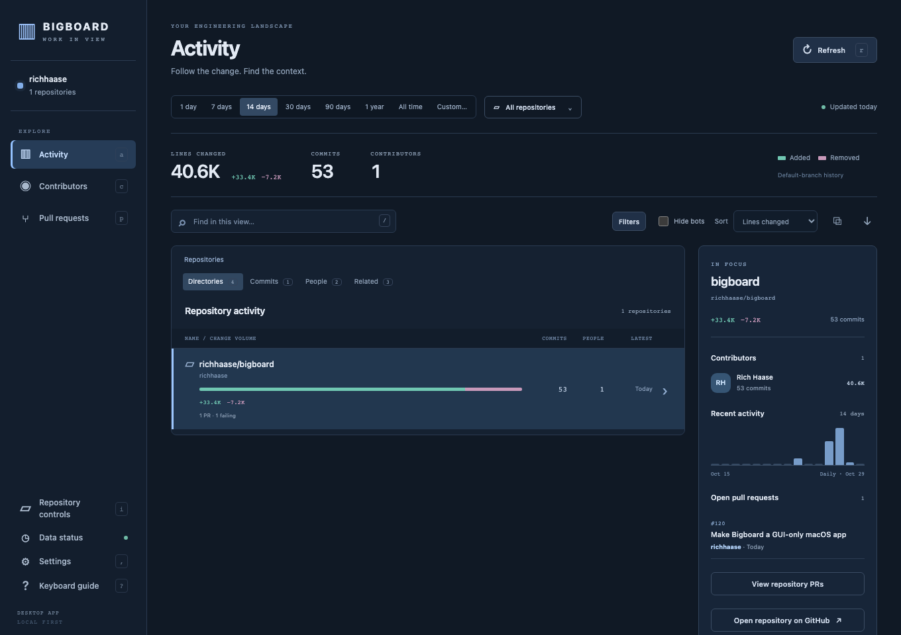

# Bigboard

A desktop app for understanding activity across your GitHub repositories:
where change happened, who contributed, and which pull requests need attention.
Inspired by Hiro Protagonist’s Big Board in Neal Stephenson’s *Snow Crash*.

Bigboard reads default-branch history and open PRs into three connected boards.
It maintains its own Git cache, leaving developer checkouts and working branches
untouched. Available cached history appears before the startup refresh finishes.



*Live data from the public [richhaase/bigboard](https://github.com/richhaase/bigboard)
repository. See the [workflow guide](docs/visual-guide.md) for the other boards.*

## Try this branch locally

This branch prepares v1.1.0 with built-in GitHub sign-in. On macOS, build it
with Go and the Xcode command line tools:

```sh
make build
open desktop/build/bin/Bigboard.app
```

Git 2.31 or newer is required for repository history. Bigboard connects directly
to GitHub; GitHub CLI is not required. Open **Settings** and choose **Sign in with
GitHub**. Authorize Bigboard in your browser, then use **Manage repository access**
to select the repositories it may read. Choose your personal account,
organizations, or both, click **Discover repositories**, and save your selection.
Organization approval and access policies still apply.

Local builds need the publisher's GitHub App build settings to enable sign-in;
see [publisher setup](docs/github-app.md). Homebrew releases include those settings.
Settings edits `$XDG_CONFIG_HOME/bigboard/config.json` (default
`~/.config/bigboard/config.json`), preserving advanced analysis preferences.
You can also use **Cached history** without network requests. No sample records
are substituted when data is missing.

## Three views of the same work

| Board | Explore |
| --- | --- |
| Activity | Compare repositories, drill into directories and files, and inspect scoped commits, contributors, and related work. |
| Contributors | Select a person to see repository distribution, timelines, the activity calendar, and recent commits. |
| Pull requests | Filter open PRs by author, review, checks, draft state, and work needing your attention. |

Date and repository viewing scope apply across all boards. Each board retains
its own search, filters, sorting, and navigation. The initial range is **14 days**,
or the saved configuration’s startup range. Change volume describes activity,
not productivity; approved reviews and passing checks are not merge authorization.

Use the sidebar and toolbar controls, or `a`, `c`, and `p` to switch boards.
`f` opens Filters, `t` opens dates, `r` refreshes, and `?` or F1 opens the keyboard
guide. Quit through the application menu or the usual macOS shortcut.

## Distribution

The next tagged release is configured to ship a signed, notarized universal
macOS app for Apple silicon and Intel, with macOS 13 Ventura or newer required. The
existing Homebrew cask name will install **Bigboard.app**, plus Git:

```sh
brew install --cask richhaase/tap/bigboard
```

Until that release is published, use the local build above to try this version.
Launch the app from Finder, Spotlight, or the Dock. The GUI distribution installs
no `bigboard` command and needs no Go, Node, or separate web server at runtime.

This replaces the terminal product and its Linux downloads. Homebrew upgrades
replace the old command with the app; scripts using `bigboard --export` must move
to **Export JSON** on Contributors. Settings remain in the XDG configuration file. Repository evidence and bookmarks
are isolated by GitHub account.

## Development and documentation

`make dev` runs native development mode. `make preview` starts an optional
loopback web server for development; it is not how the installed app runs.
`make test` checks both Go modules and the frontend models. See the
[desktop development guide](desktop/README.md) for prerequisites and browser checks.

- [GitHub app setup](docs/github-app.md): publisher registration and authentication boundaries.
- [Workflow guide](docs/visual-guide.md): a tour of the boards and dialogs.
- [User reference](docs/reference.md): settings, controls, identities, storage, and counting rules.
- [Workflow coverage](desktop/parity.md): supported behavior and verification boundaries.
- [Development context](CLAUDE.md): architecture and implementation contracts.

## License

[MIT](LICENSE)
