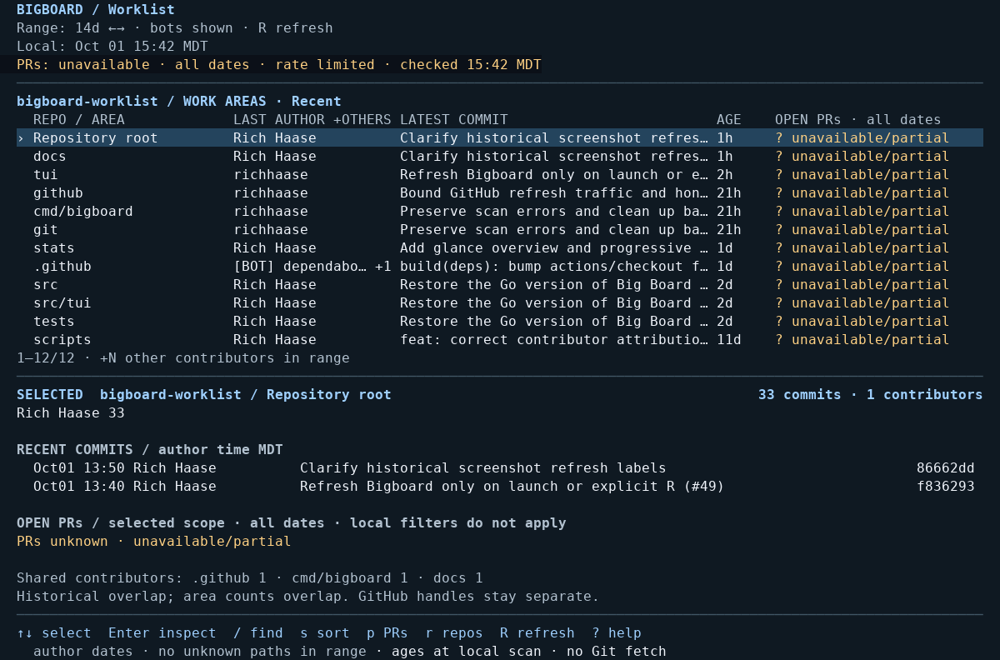

# Big Board

A terminal situational-awareness board for seeing who has worked where across your Git repositories, how that work connects, and the commits behind it. Inspired by Hiro Protagonist's Big Board from Neal Stephenson's *Snow Crash*.



*Activity at 120 × 36, with `tui` selected in Bigboard's own public Git history.
The lower pane shows the contributors, commits, and related areas behind that
selection. The capture omits `gh`, so PR context is
shown as unavailable rather than zero. Local and PR snapshots refresh on launch or `r`.*

[Take the visual tour](docs/visual-guide.md) for the views, navigation, and how to
read the counts. [Controls](#controls) · [Configuration](#config-file) ·
[GitHub PR context](#automatic-github-pr-awareness)

## Install

Big Board requires Git 2.31 or newer on `PATH`. Partial clones require Git
2.45.1 or newer so scans can reliably disable automatic object fetching.

### Homebrew

```bash
brew install --cask richhaase/tap/bigboard
```

### From Source

```bash
go install github.com/richhaase/bigboard/cmd/bigboard@latest
```

## Usage

Big Board is TUI-first: preferences live in the config file, and the CLI has exactly four flags.

```bash
# Analyze current directory
bigboard

# Analyze specific repos or scan directories for repos
bigboard ~/src/repo1 ~/src/repo2
bigboard ~/src/

# Use a named group from your config
bigboard --group backend

# Print contributor stats as JSON and exit (all-time window)
bigboard --export ~/src/ > board.json

# Use an alternate config file
bigboard --config ./bigboard.json

# Print version and exit
bigboard --version
```

The shared scope row shows the active range. Press `t` to open Date range in the
filter modal. Space stages a preset or opens custom entry for 1–3650 days;
Enter applies pending choices and Esc cancels.
Range changes filter the loaded history in memory, with no scan or fetch.
The initial range defaults to 14 days. Set
`since` in the config to choose the initial range. `--export` always covers
all time; per-contributor first/last commit dates are included for reference.
Those dates alone cannot reconstruct totals for a narrower time window.

## Work relationships

Activity ranks repositories by **lines changed (added + removed)** in the selected
period, with a contributor breakdown for the highlighted scope. Bars show the balance
of added and removed lines. Commit counts remain visible; `s` can sort by commits
without changing what the bars measure.
Quiet repositories stay visible, and unknown line totals remain marked with `?`.
These are activity measures, not productivity or priority scores.

Press `Enter` to inspect a repository's immediate directories and files. Each
level uses the same ranked bars, commit and contributor counts, and recency.
Directory line totals sum only the files in that directory, using the per-file
counts retained from Git. Enter a directory to see its children; enter a file
to see its commits. The date range and bot filter carry through every level.
`Esc` returns to the parent with its selection and search preserved.

`+N` beside the latest contributor counts the **other distinct contributors** in
the current local range and bot filter. It is not an online-presence count. The
evidence preview is ranked by scoped commit count; `+N more` means that preview is
bounded. People retains the full alphabetical list. GitHub handles remain separate
from canonical Git identities. Ages are fixed at each repository's last successful
local scan; future author dates are labeled `future`.

Commit, People, and Related evidence remains available as secondary views.
Configured named work areas retain their separate grouping; the directory
browser uses literal paths and does not silently merge directories. In detail,
`Tab` / `Shift+Tab` or `1`–`3` switches Commits, People, and Related; `4`
returns to the directory ranking. Only one detail surface is expanded at a time.
Commits shows real subjects with
author-date evidence, contributor identity, and short object IDs. `Enter` opens a
scrollable inspector with the
full subject, canonical contributor identity, timestamp, object ID, and all changed
paths. People is alphabetical; selecting a person filters Commits. Related lists
exact commits touching both areas, their counts, and the latest shared title;
`Enter` opens those commits and then their full changed paths. Contributor overlap
is separate: it lists names appearing in both areas in the selected range. Press
`m` in Related for its scrollable overlap list, then `Enter` for names and their
identity-filtered evidence.

Subareas refines automatic path areas by one literal directory level at a time.
Direct files are a separate leaf; multi-path commits can appear in several children.
Configured named areas keep their explicit meaning and are not automatically
reinterpreted. `Esc` returns through each level, restoring the prior selection.
`/` searches the current list. Enter accepts the query; Esc during editing restores the previous query. After editing, Esc navigates back and keeps applied searches. Use `x` to clear board filters and search. `?` opens help for the current screen. `c` switches to the Contributors board. Date and repository viewing scope apply to all boards. Bot visibility is independent on Activity and Contributors; refresh coverage is managed separately.

Work areas are path-based groups, not inferred features or ownership. Automatic
grouping expands containers such as `src`, `services`, `packages`, `apps`, `cmd`,
and `internal`, so `services/auth` and `services/payments` appear separately.
Definitions use the full scan and stay stable while changing the time range.
Root files, excluded-file-only commits, empty commits, and unknown shallow-boundary
paths have explicit groups. Binary files count as activity even without line counts.
A commit can appear in several areas; area counts overlap and must not be summed.
Only destination paths assign rename/copy pairs to areas; the previous path is
shown as evidence, without treating an unchanged copy source as work.

For meaningful cross-directory groups, optionally configure `work_areas`:

```json
{
  "work_areas": {
    "my-monorepo": [
      {"name": "Authentication", "paths": ["services/auth", "apps/web/src/auth"]},
      {"name": "Payments", "paths": ["services/payments"]}
    ]
  }
}
```

The repository key is its unique display name or absolute path (absolute path
wins). Prefixes are literal repository-relative files or directories, not globs.
The longest matching prefix wins; unmatched paths keep automatic groups. Names
must be unique within a repository, and one prefix cannot name two areas.
The existing `depth` setting still controls repository discovery only.

The board updates local repository data only on launch and when you press `r`.
There is no periodic auto-refresh. “Local” shows the last successful local
refresh for the selected repository; “Updating…” keeps the existing view usable during a refresh.
Startup and `r` fetch included repositories from `origin`, then scan local history
and request GitHub PR context subject to the PR cooldown described below. Export
scans cached history without fetching. Fetches update remote-tracking branches only;
local branches, tags, working trees, and submodules stay untouched. Repositories
without `origin` remain local-only. Fetches use existing Git credentials, disable
interactive prompts, and run at most eight repositories at once with a two-minute
fetch timeout per repository. A failed fetch still allows the local scan, with a
STALE marker and diagnostics under `e`; a failed scan retains that repository's
last successful data. A successful fetch and scan, including an empty one, clears
the stale state. The board
requires at least 40 columns by 18 rows. Narrow or short terminals keep one primary
surface with the same controls. In area lists, two-line rows at 80 columns keep
names and subjects readable. `Enter` replaces the list with detail; `Esc` restores its
selection and scroll position. At 40 columns, each area row uses three lines. Shallow,
stale, failed, partial, and unknown data remain visibly qualified.
Statistics retain their wide layout; narrow contributor detail uses labeled
repository metrics so every value remains readable. On short terminals, contributor detail
uses `PgUp` / `PgDn` to scroll and `Home` / `End` for the first or last page;
`↑` / `↓` still switches contributors. Its navigation remains visible while
scrolling through the timeline and activity matrix.

Contributor timelines use daily buckets for ranges up to 30 days, weekly buckets
for 31–180 days, and monthly buckets for longer ranges or All time. Daily and
weekly timelines include quiet dates within the selected range; their bars still
show added and removed lines, alongside commit counts. For ranges up to 180 days,
the activity matrix shows only the covered calendar dates, including partially
covered boundary days. Its date caption identifies the visible interval when a
narrow terminal cannot fit the whole range.

## Automatic GitHub PR awareness

Read-only open pull request context loads automatically for supported GitHub
origins using an already installed and signed-in `gh` CLI. No config setting is
needed.
Missing `gh` or authentication is shown without blocking local history. Bigboard
never signs in, requests access, creates credentials, or changes pull requests.
Headless `--export` stays local and unchanged.
Only a supported GitHub `origin` is used, with no upstream guessing.

PR counts appear beside existing Activity repository and directory/file rows
when width permits. Wide rows show open, failing-check, and changes-requested
counts separately; smaller rows show only open counts. These signals do not
change the line bars, ranking, or contributor pane. A `?` marks incomplete or
stale evidence; directory counts also need complete current-file lists for the
repository's in-range PRs. Failing checks and changes requested can overlap.
Labels appear once in the column header. A muted dash means no open PRs;
blank failing/changes cells mean zero, keeping attention on nonzero counts.
Press lowercase `p` for all included repositories, `f` within PRs to choose one
repository, or `v` from Activity for its selected repository. Enter opens a
scrollable detail modal over the retained PR list; left / Esc closes it. Details show the canonical link, GitHub author and reviewers,
aggregate review decision, check rollup, mergeability and update time. GitHub
handles remain separate from local Git contributor identities. `UNKNOWN` is not
approval or merge readiness; “updated” includes any PR activity.

Changed file paths map to the same configured prefixes and automatic Work areas
as local history, including new PR-only areas. Generated files follow `all_files`.
A PR touching multiple areas appears in each; the overall count deduplicates it,
including across duplicate local clones. The PR board follows the global range
using PR last-updated time; local contributor and bot filters do not apply.
Activity PR counts and work-area summaries follow that shared scope, independently
of saved PR-board filters. Fetch coverage retains all open PRs. PRs never enter
commit totals or the JSON export.

The initial remote refresh runs after the local scan without blocking navigation.
`r` fetches repository history and refreshes PR context, including inside the PR
board. Repeated PR refreshes reuse in-memory snapshots for at least one minute and
join an in-flight remote refresh rather than canceling and restarting it. Excluded
repositories are not fetched. The entire remote refresh shares a request cap
(`pr_request_budget`, default 128). All repository inventories are requested before
additional file pages, which are fetched newest-PR-first across repositories.
Inventory queries retain the first 100 files per PR to avoid extra calls for
ordinary PRs. Data status separates inventory coverage from file/reviewer details
and shows request use for account lookup, inventory and additional-file phases;
repositories left unfetched retain explicitly stale/partial evidence. Rate limits
pause all remaining requests, honor GitHub's reset/Retry-After time, and use bounded
exponential cooldowns when no retry time is available. The PR board status shows when `r`
can request data again; no background retry runs. There is no polling or disk cache,
so a new process starts a fresh remote refresh. Failed or incomplete inventories retain
last-good evidence with visible stale/partial labels; a complete open inventory
clears missing PRs even when supporting context is partial. `PARTIAL` repository
status means the inventory is incomplete; missing files are qualified as unknown
areas on the affected PRs and directory counts. Prior file lists are reusable only
when the PR's update time and head/base revisions still match. Each repository refresh is bounded to 200 open PRs,
1,000 file paths per PR, half the configured request budget (at least one request),
and 90 seconds, within a two-minute overall
refresh. Reviewer lists are also bounded and visibly partial when truncated.
No PR descriptions, comments, diffs or check logs are requested. GitHub's GraphQL
file list does not expose rename origins, so that limitation is labelled rather
than guessed. Authentication, rate limits, unavailable repositories and unsupported
origins are reported in the PR board without suppressing local history.

## Accuracy notes

- **Author identity** is resolved by Git's native `.mailmap`, then the configured `identities` email aliases, and grouped by canonical email. Press `m` on the Contributors list to merge a person's email identities and save the mapping. Shared or similar names do not merge people. Missing-email identities are scoped to the repository and exact name. The legacy `fuzzy` preference is accepted but no longer changes identity matching. Selection follows the identity when its display name changes across time ranges.
- **AI authorship** is detected from specific known agent authors and `Co-authored-by` identities, including agent accounts that commit via GitHub (`Copilot`, `claude[bot]`, `devin-ai-integration[bot]`, `google-labs-jules[bot]`, …). Working at an AI company does not classify someone as an agent. Add your own agents' emails or explicit `@domains` under `ai_identities`. Sorting compares exact AI ratios; percentages are rounded only for display.
- **Bots are counted, not hidden.** Bot accounts (`dependabot[bot]`, `renovate[bot]`, your own agents via `bot_identities`) rank on Contributors with a `BOT` tag; press `b` to toggle them out of view.
- **Generated & vendored files** (lockfiles, `vendor/`, `node_modules/`, `dist/`, `*.min.*`, `*.snap`, `go.sum`, …) are excluded from line counts by default so they don't inflate scores. Set `"all_files": true` to count everything.
- **Scope** is each repo's default branch, excluding merge commits. Cached remote default history is preferred over the local branch; local `main`/`master`, then `HEAD`, provide fallbacks. Startup and `r` fetch included repositories before scanning; export uses cached history. Locally divergent commits outside that selected history are excluded. Branches are resolved to commit IDs so same-named tags cannot change the history. Rename/copy changes use `-M -C` with explicit diff settings and literal, NUL-delimited filenames.
- **Shared commits** count once across selected repositories, by Git object ID. Repository subtotals retain every association and can overlap; do not sum them to obtain board totals. When copies have different mailmaps, attribution comes from a complete copy first, then the lowest repository ID, deterministically. Filtering a repository out also removes it as a source of attribution/counts.
- **Calendar dates** use your local timezone for active days, monthly totals, first/last dates, and heatmaps. Future-dated commits remain counted; ALL includes every collected commit and recent windows retain their existing lower-bound filtering. Churn remains removals/additions, with `0.00` when additions are zero.
- **Incomplete history** is flagged for shallow clones. Boundary line counts are unknown, shown as `?` or a known subtotal followed by `?`. A complete copy of the same commit can supply its missing counts. JSON export keeps numeric known subtotals and includes `unknown_line_commits` on contributor/repository objects when nonzero; stderr reports shallow repositories. Partial clones with missing objects are reported as scan failures instead of downloading data.

## Board layout

Activity, Contributors, and PRs share the title, scope/search row, separate local
and PR freshness rows, and pinned footer. Their list headings show the active
sort and visible row range in the same place, followed by column labels and rows.
Search text stays in the scope row while typing and after acceptance.

Contributors totals use a compact summary in its list heading. PRs use columns
for repository, PR number, state, author, title, review, checks, and updated age at wide widths;
80-column rows stack title and metadata, and 40-column rows put review/check/age
on their own line. Titles shorten before status fields. PR ages use their
snapshot's check time. At 70×24 and above, a selected-PR preview above the footer
shows its full repository identity, wrapped title, author, draft state, and
separate review/check states. Very long titles continue in Enter detail, and
the preview reserves room for at least three list entries. Repository labels
omit the owner only when the name is unique across included PR repositories.
Drafts use a `◇` state marker and subdued titles; `●` identifies open non-draft
PRs. Approved reviews and passing checks are green, independently of draft state.
Neither signals that branch protection or merge readiness has been evaluated.
Activity's repository and directory inventories show ranked bars, commit and
contributor counts, and changed-line totals. A compact contributor breakdown
beneath the ranking follows the highlighted repository, directory, or file. It
ranks contributors by added + removed lines and shows commits and split bars
using only that scope's files. The panel shows up to five contributors, scales
down in shorter windows, and yields to the ranking in very small terminals.
Tab moves focus into the contributor pane; arrows, paging, and Home/End browse
every contributor. Tab or Esc returns to the ranking. A highlighted heading and
thick side marker identify the active pane; the other pane keeps a quiet border.
Bars always show added and removed lines; `s` changes sorting among lines changed, commits,
recent activity, and name. Contributors detail provides the inverse view: the
selected person’s repositories, ranked by the same line-change measure.
Enter opens a deeper directory or a file's commit history. Commit evidence uses
the available height and pages by visible commits.

All three boards share an in-memory **date range and repository viewing scope**.
`f` opens the same centered filter modal; `t` opens its Date range category directly.
Shared choices apply to every board. Activity has Git contributor and bot filters;
Contributors has its own bot setting; PRs has Mine, GitHub author, review, checks, and
open/draft filters. Each board keeps its own search. Git identities and GitHub
authors remain separate. Viewing filters do not change repository tracking or
refresh coverage; `i` opens repository controls in a centered modal over the
current board. Space stages inclusion choices, Enter applies, and Esc cancels.
Arrows, Page Up/Down, and Home/End navigate the list. Inclusion choices keep
their existing session-only behavior.

In the filter modal, left/right or Tab changes categories, up/down selects an option,
and Space stages a choice. Multiple values within a category match any selected
value; different categories must all match. Enter applies all staged choices;
Esc cancels. `/` finds options, and the Search category edits the board search.
Custom days are validated before being staged, then applied with the other choices.
Reset shared selects All time and all tracked repositories. Reset this board
clears its filters and searches while preserving shared scope and navigation.
`x` performs that board reset directly. Active shared scope and board filters
have separate rows beneath the title; cached inventory has a separate status row.

The footer separates board navigation, a few contextual actions, and help/refresh
into compact groups. Keys are brighter than labels. Extra shortcuts live in `?`
help rather than expanding the footer on wide screens; narrow screens omit whole
hints. Coverage stays on its own row. Narrow Contributors rows stack contributor/commit counts
above net change and AI share.

## Controls

BigBoard has three peer boards. Lowercase `c`, `a`, and `p` resume Contributors,
Activity, and PRs. Each remembers its filters, sort, selection, scroll, and
navigation location. Board switching cancels pending filter/repository choices
and dismisses temporary dialogs. Re-selecting the current board preserves its
location. Applied filters are cleared explicitly, never by Back.

| Key | Shared behavior |
|-----|-----------------|
| `c` / `a` / `p` | Resume Contributors / Activity / PRs |
| `↑` / `↓` | Select rows in lists; scroll lines in details |
| `PgUp` / `PgDown` | Move a page in lists and details |
| `Home` / `End` | First / last row or detail page |
| `→` / `Enter` | Open the selected item or drill down; does not toggle detail closed |
| `←` / `Esc` | Close or return one level; preserve applied filters; stay at board roots |
| `/` | Search the current board list or Activity lens; reopen the existing query for editing |
| `s` / `S` | Change sort / reverse order in sortable lists |
| `f` / `t` | Open Filters / open its shared Date range category directly |
| `x` | Clear this board’s filters and search; preserve shared scope and location |
| `i` | Open Repository controls to choose tracked repositories and refresh coverage |
| `r` | Fetch included repositories and request PR context, subject to PR cooldown; preserve location |
| `e` | Open Data status for Git/PR freshness, coverage and diagnostics |
| `?` / `F1` | Open contextual help |
| `q` / `Ctrl+C` | Quit outside text entry; `Ctrl+C` always quits |

Uppercase `R` remains a compatibility alias for refresh. Repository inclusion
uses `i`, so refresh and inclusion no longer differ only by letter case.

During search entry, ordinary characters, including shortcut letters and `?`,
enter text. `Enter` accepts the search, `Esc` restores the previous applied search, and `Backspace` edits. `Ctrl+U` clears the edit buffer.
`F1` opens help while typing. Help is a centered, scrollable modal: arrows,
paging, and Home/End scroll; `Esc`, `Enter`, `?`, or `F1` dismiss it. Board keys
can leave help directly. Dialogs own their other keys while open.

Help starts with the current board, focused pane or modal controls, then lists
shared filters and board navigation. Shared commands appear once. Footer hints
prioritize the current context and keep help available; secondary actions remain
in the help modal. Filter editors show `F1` for help while typing.

`e` opens Data status in a centered modal over the current board, even when
there are no errors. Git/PR freshness and tracked-repository coverage appear
first; `d` shows repository diagnostics. Arrows, paging, and Home/End scroll
the modal, `r` refreshes, and Esc closes it without changing selection or filters.

### Activity

Activity shows included repositories and their default-branch history in the
selected local time range. `→` / `Enter` drills through repositories, directories,
files, and commit details. `←` / `Esc` returns to the parent, preserving board filters and searches. At the repository root it stays there; use `q` to quit.

| Key | Activity behavior |
|-----|-------------------|
| `Tab` / `Shift+Tab` | Move focus between the ranking and contributor pane |
| `1`–`3` | Open Commits / People / Related for the current directory scope |
| `Tab` / `Shift+Tab`, `1`–`3` | Switch detail lenses |
| `4` | Return to the directory ranking |
| `s` / `S` | Change sort / reverse order; directories support Lines +/- / Commits / Recent / Name |
| `t` | Edit the shared date range |
| `b` | Show / hide bot contributors on Activity |
| `v` | Open the PR board scoped to the selected repository, including from area or commit detail |
| `m` | In Related, switch between shared commits and contributor overlap |

People, Commits, and Related keep their meaningful fixed ordering. In People,
Enter opens that contributor's commits. Related opens the selected evidence. The full commit inspector uses arrows and paging to scroll; `←` / `Esc`
returns to Activity. `Tab` / `Shift+Tab` leaves it for the next / previous lens.
`r` refreshes directly from the inspector without changing the selected commit.

### PRs

The PR board shows open PRs across included repositories updated within the
global date range. `t` changes that range for all three boards; All time restores
all open PRs. Missing update timestamps appear only in All time. Local person
and bot filters do not apply. `f` edits shared repositories and PR filters in one
modal. `u`, `v`, `k`, and `d` open its author, review, checks, and state categories.
The Mine category offers **Authored by me** and **Review requested from me**.
It uses the current GitHub account from `gh`, resolved once per remote refresh
within the same request budget and cooldown. Select both to include either kind
of PR; other facets and search still narrow the results. Review requests match
explicit user logins only; team membership is not inferred. Bounded reviewer
coverage may omit requests, as reported in Data status and PR details. If the
account cannot be resolved, Mine shows the reason and selected Mine filters show
no results. Git contributor aliases do not affect these filters.
Activity's `v` opens a contextual repository PR view with the shared range and
repository scope, temporarily omitting unrelated saved PR filters. Back from its
list returns to Activity. Leaving this context restores the normal PR board's
saved filters and selection. Plain `p` resumes that saved normal PR board.

Enter opens a centered detail modal with a wrapped title, author and draft state,
colored review/check fields, conflict status, and sections for coverage,
reviewers, affected areas, and changed files. PR identity, incomplete-snapshot
warnings, and close/browser controls stay visible while scrolling. Esc restores
the same list selection and filters.

`/` searches repository, title, author, or `#number`. `s` cycles Updated,
Repository, Author, and Title; `S` reverses the order. Updated defaults newest
first. The heading shows the active scope and sort; accepted search text stays
visible. Enter / right opens PR details; left / Esc closes details and preserves
applied filters. Back from a temporary Activity PR context restores Activity;
at the normal PR root it stays on PRs. All lists and details support arrows,
paging, and Home/End.

`o` opens the selected PR in your default browser from the list or detail when
its canonical GitHub URL is valid. Launch errors appear on the board. `r`
refreshes repository history and PR context from list or detail. `i` changes
global inclusion and returns to the same PR view.

### Contributors

Press `m` on the Contributors list to merge identities across repositories. The
modal shows all collected names and emails, including contributors outside the
current date range. Space selects identities, `k` chooses the primary email,
`n` sets an optional display name, and `/` searches. Enter reviews the full email
mapping; a second Enter confirms and saves it. Esc returns to editing or cancels.
Identities without a valid email cannot be merged.

Confirmed merges persist in the active config file and apply to every board and
JSON export. BigBoard rescans cached local history without fetching Git or PR
data, preserving your scope and contributor selections. Unrelated settings stay
intact; if the config changed externally or saving fails, the original mapping
and your staged choices remain available.

Contributors aggregates included repositories in the selected local history
range. Bars always show added and removed lines, including when sorted by commit
count. `/` filters contributor names; `s` selects a sort field and `S` reverses it.
`b` toggles bots and `t` changes the range. Enter / right opens contributor detail.
In detail, arrows and paging scroll the same contributor; left / Esc returns to
the list. Select another contributor there to open their detail. `i` and `r`
remain available in detail. At the list root, Esc stays there and preserves
applied searches; `x` clears board filters and search. `q` quits immediately.

### Dialogs

Repository tracking is session-wide and separate from shared viewing scope.
Use arrows, paging, and Home/End to select a repository, and Space to toggle it.
Enter applies choices; Esc / left cancels. Exclusion removes a repository from
all boards and subsequent fetch/PR requests. It does not write the config file.

`t` opens Date range in the shared filter modal on all three boards and their details.
It uses commit author time for local history and last-updated time for PRs.
Choose 1d / 7d / 14d / 30d / 90d / 1y / all / Custom days. Home selects the first
preset; End selects Custom. Space stages a preset or opens day entry.
Custom entry accepts 1–3650 days; Backspace edits and Ctrl+U clears it. Enter
stages a valid custom range; Enter from the options applies the whole draft.
Esc cancels. Custom ranges are session-only. Range affects all three boards;
Activity and Contributors each keep their own bot visibility.

## Config file

Optional, at `$XDG_CONFIG_HOME/bigboard/config.json` when `XDG_CONFIG_HOME` is set,
otherwise `~/.config/bigboard/config.json`. Override either with `--config`.
Malformed JSON, unknown fields, and unsupported `sort`, `since`, or `theme` values
report an error. Settings are read at startup;
interactive filters and inclusion changes do not rewrite the file. Confirming a
contributor merge explicitly saves its identity mapping to this file.

```json
{
  "paths": ["~/src"],
  "exclude": ["vendor-*", "org-a/api"],
  "sort": "net",
  "since": "90d",
  "theme": "dark",
  "fuzzy": false,
  "all_files": false,
  "depth": 2,
  "pr_request_budget": 128,
  "groups": {
    "backend": ["~/src/api", "~/src/workers"],
    "frontend": ["~/src/web"]
  },
  "ai_identities": ["my-agent@example.com", "@agents.example.com"],
  "bot_identities": ["my-agent@example.com"],
  "identities": {
    "dev@example.com": {
      "aliases": ["dev@personal.example", "12345+dev@users.noreply.github.com"],
      "name": "Example Developer"
    }
  }
}
```

- `paths` supplies scan roots when no positional paths or `--group` are given; without any of these, Bigboard scans the current directory.
- `depth` controls recursive repository discovery, with a default of `1`; values below `1` also use `1`. It does not change work-area grouping.
- `sort` sets the Contributors sort: `commits`, `added`, `removed`, `net`, `ai`, or `total` (`impact` is an alias for `total`). The default is `total`. This setting changes contributor ordering; bars still show lines changed. Activity starts ranked by lines changed and can independently sort by commits, recency, or name.
- `theme` accepts `auto`, `light`, or `dark` as a terminal-background hint; the current Activity canvas uses its fixed high-contrast palette.
- `all_files` includes generated/vendored paths in line totals; it defaults to `false`.
- `work_areas` defines optional cross-directory groups using the [rules above](#work-relationships).
- `pr_request_budget` is the positive maximum number of GitHub requests per refresh (default `128`). It does not change rate-limit cooldowns, timeouts, or the PR/file count limits.
- `since` takes a preset label: `1d`, `7d`, `14d`, `30d`, `90d`, `1y`, or `all`, with a default of `14d`.
- `fuzzy` is retained for config compatibility; use `.mailmap` or `identities` for identity aliases.
- `exclude` entries match a repo basename, a unique display name like `org-a/api` (for duplicate basenames), or a glob of either.
- `ai_identities` marks commits by those authors (or co-authors) as AI-assisted; entries are exact emails or `@domain` suffixes.
- `bot_identities` tags contributors as bots; entries are exact emails, `@domain` suffixes, or exact author names.
- `identities` maps each canonical email to `aliases` and an optional display `name`. Keys and aliases are trimmed and lowercased; each email may appear only once across the map, and self-aliases are rejected. Names alone never merge people. Mappings apply after Git's `.mailmap`, before author AI/bot classification, to all boards and JSON export. Co-author AI evidence is preserved. Without a display override, the most frequent name remains the display name. An incorrect alias assigns someone else's commits to the canonical identity; check the People lens after editing the map.
- Select a group with `--group backend`. Author identities can also be canonicalized with a standard git `.mailmap` in each repo.

## Features

- Relationship-first repository and work-area views, cross-scope contributor focus, and scrollable commit/path evidence
- Local updates on launch or `r`, separate local/PR freshness, and retained last-good data on refresh failures
- High-contrast Activity with responsive full-width evidence and compact list-to-detail navigation
- Streaming repository-scan loader that surfaces unreadable repos as they load
- Gradient impact bars with trailing glow; gold/silver/bronze rank styling
- AI-authorship as a first-class metric: Contributors `AI%` column, per-month AI share, per-repo AI %
- Bot contributors counted and tagged (`BOT`), with a one-key toggle to hide them
- Per-contributor drill-down: repo breakdown, gap-aware monthly timeline, neon contribution heatmap, and derived metrics (active days, first/last commit, churn)
- Scrollable, height-aware Contributors board with incremental `/` search — every contributor reachable
- Headless `--export` (JSON, same pipeline and identity policy as the TUI), config file with named `--group`s, glob excludes, and recursive scan depth
- Accurate-by-default: native `.mailmap`, generated/vendored files excluded, deterministic ordering, rename/copy-aware churn
- Git worktree detection (linked worktrees are skipped); separate-Git-directory repositories are supported, and symlinked repo directories are followed and deduplicated

## License

MIT
