# Activity visual guide

[README](../README.md) · [Full controls](../README.md#controls) ·
[Configuration](../README.md#config-file) · [PR context](../README.md#automatic-github-pr-awareness)

Bigboard starts with repository change volume, then literal directories and files,
with contributors and commits available as scoped evidence. Run `bigboard ~/src/` for multiple
repositories or `bigboard /path/to/repo` for one. A single included repository
opens directly into its directories.

All screenshots in this guide are **actual terminal captures of Bigboard's own
public Git history**, not mockups or fixture data. They use the 14-day range with
bots shown; the custom entry shows an unapplied 21-day value. The capture
environment intentionally omits `gh`; the UI reports unavailable PR context
and keeps local history usable. These captures predate the repository ranking
and Contributors rename; the current controls and behavior are described below.
See [capture details](#capture-details).

## Scan work, then inspect its evidence

*Overview, 120 × 36. `tui` is the only selected row. The list shows where recent
work happened; the lower pane explains that selected area's history.*

Within each commit preview, the author/date/hash and changed areas are indented
beneath the title.

At the repository level, compare **where change occurred** using a
ranking with bars. Added + removed lines is the default sort; commit counts stay
visible and sortable. Bars always show added and removed lines. Counts follow the
current range and bot filter; quiet repositories remain visible, and unknown line
totals keep their `?` qualifiers. A compact contributor breakdown follows the
highlighted repo or directory, ranking people by their scoped added + removed
lines. It shows up to five people and reduces or hides itself in small windows
to preserve the main ranking. Tab focuses the contributor pane so arrows,
paging, and Home/End can browse all contributors. Tab or Esc returns focus to
the ranking; Enter does not open another view from the scrolling pane.
Enter opens a literal directory/file ranking with the same columns and bars.
Directory totals count only the changes to files inside that directory. Enter
a directory to go deeper, or a file to see its commits. Configured named work
areas retain their separate meaning in secondary evidence views. These measures
do not indicate priority or productivity.

- `↑/↓` selects a repository, directory, file, or evidence row
- `→` or `Enter` opens repository → directories → files → commit evidence
- `←` goes back with selection preserved; at the repository root it stays there
- `+N` beside the latest author counts the other distinct contributors in the
  current local time range and bot filter, not the number of extra commits
- Counts beside names in the lower pane are scoped commit totals. `+N more`
  means the older area preview is bounded; `2` opens the current scope's
  full alphabetical People list
- Ages are calculated at each repository's last successful local scan. They
  do not tick or imply a new scan. Future author dates say `future`
- `t` opens the range picker, `b` toggles bots, and `/` searches the active list

One commit can touch several directories, so **commit counts overlap and must
not be summed**. Line totals belong only to the files in each directory. Shared contributors describe historical overlap, not live presence
or ownership. GitHub handles stay separate from canonical
Git identities. Historical paths can appear even after removal from the checkout.

## Choose the global range

The visible **Range: 14 days · t to change** control opens with `t`. Use `↑/↓`
to choose 1 day, 7 days, 14 days, 30 days, 90 days, 1 year, or All time.
Custom days accepts 1–3650 whole days. `Enter` applies; `Esc` cancels.
The range applies to all three boards: commit author time for local history,
last-updated time for PRs. Changing range filters the loaded data in memory; it
does not scan Git, fetch objects, or refresh PR data. The startup default remains
14 days, or the `since` preset in config. Custom choices last for the session.

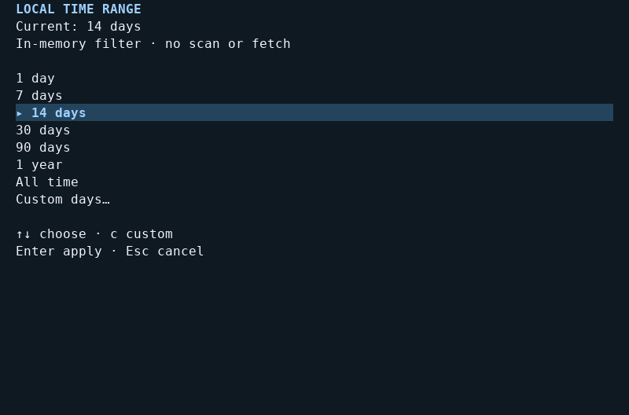

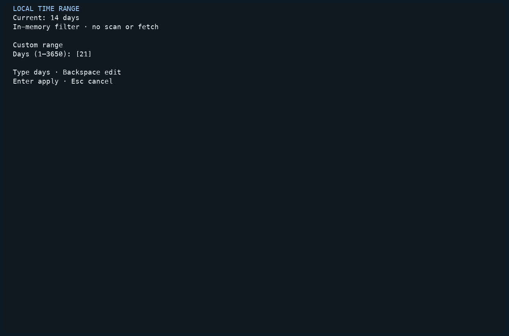

## Compact list → detail

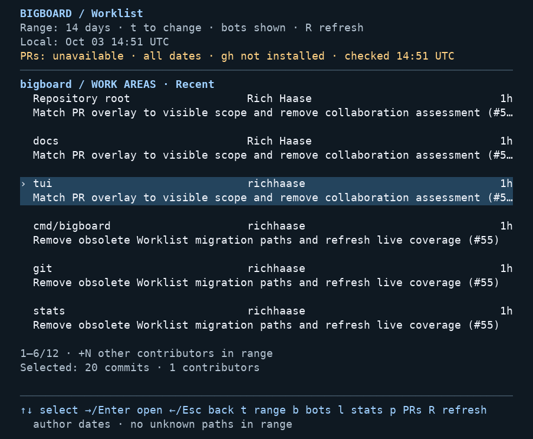

*Compact overview, 80 × 30. Six areas fit on this page. The second line preserves
the concrete commit subject rather than compressing several narrow panels.*

At 80 columns, each area uses two content lines. `Enter` replaces
the list with the selected area's evidence; `Esc` restores its selection and
scroll position. `PgUp/PgDown` pages through Activity lists, and `Home/End`
selects their first/last item.

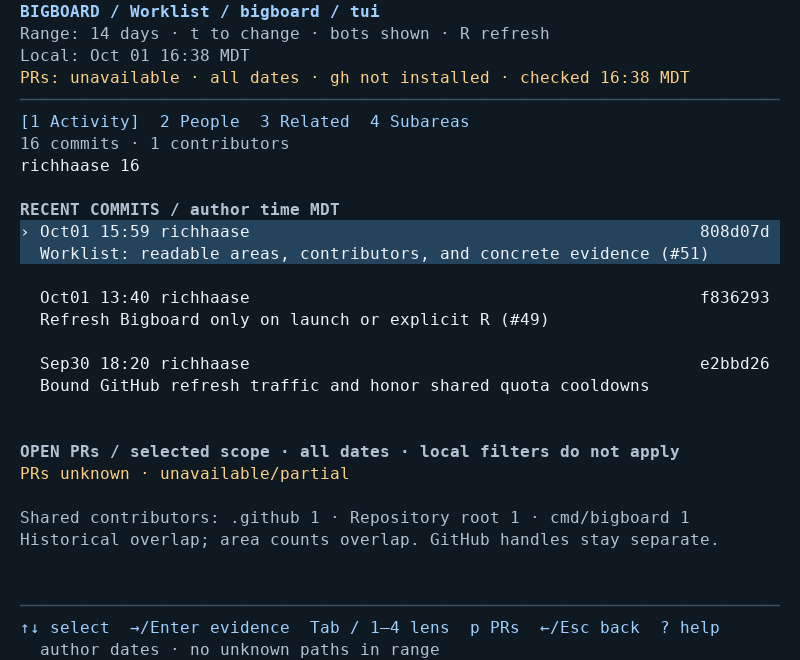

*Activity, 80 × 30. The area list is replaced by commit evidence, with only one
active cursor. `Enter` on the highlighted commit opens the complete subject and
changed-path inspector.*

The wide area overview and lower evidence pane start at **110 columns × 28 rows**.
Below either dimension, Activity uses one primary surface. The minimum supported
size is **40 × 18**:

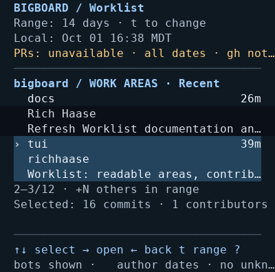

*Small overview, 40 × 18. Each item uses three lines. Long subjects and status
text are visibly truncated; detail and the PR overlay remain available for the
full evidence. The bottom keys stay on screen.*

## People: choose a canonical contributor

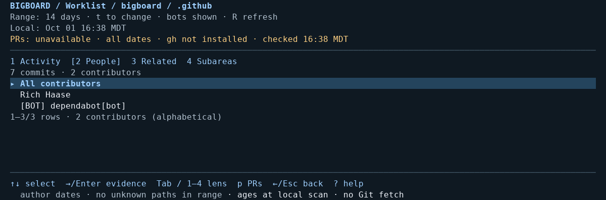

*People, 120 × 18. `.github` has two distinct Git contributors in this range.
“All contributors” is a filter-reset row, not a third contributor.*

Press `2` from an area list or detail to open People. Names are alphabetical;
bots retain their `[BOT]` tag. Identities are based on canonical Git email after
`.mailmap`, with repository-scoped identities when email is missing. Matching
names do not merge people; duplicate display names include distinguishing identity
text. Preview ranking by commit count does not change this alphabetical list.

Select a person and press `Enter` to open their scoped Activity. `Esc` returns
to People, preserving applied board filters and searches. Choosing
“All contributors” also leaves that person's focused view. These Git identity
selections never filter GitHub PRs.

## Related: separate co-change from contributor overlap

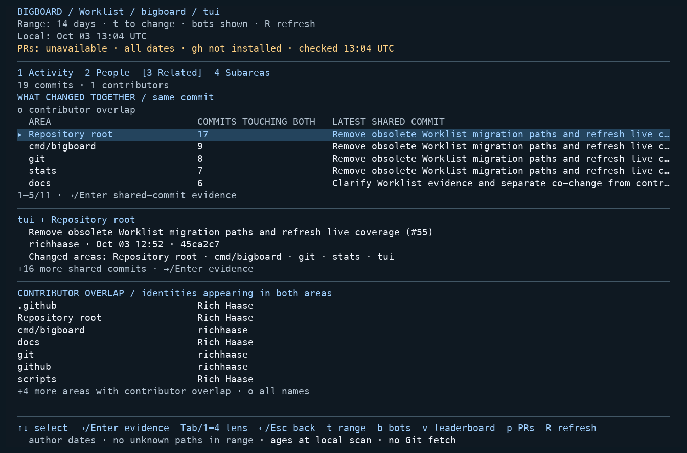

*Related, 120 × 36. The main list counts actual commit IDs present in both areas.
The selected preview shows the latest shared title, author, author time, hash,
and all affected areas.*

Press `3`, select an area, then `Enter` to inspect **only commits touching both**.
`Enter` again opens the canonical full commit and its changed paths. `Esc`
restores the previous selection. Range and bot filters apply; an Activity person
filter does not change the Related inventory. Missing commit IDs never count as
shared evidence.

The separate **Contributor overlap** section names canonical identities present
in both areas in the selected range. Press `m` for
the full scrollable overlap list, including on narrow terminals; `Enter` opens
its shared names and their identity-filtered Activity. Press `m` again to return
to co-change.

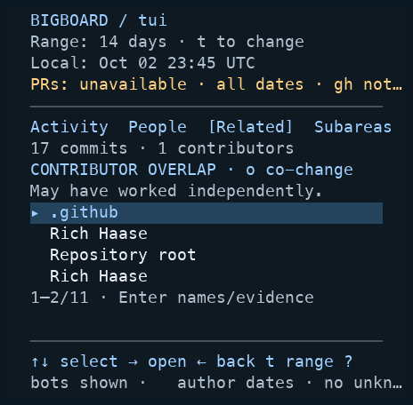

Overlap-only areas do not appear in the shared-commit list.

## Subareas: refine a path group

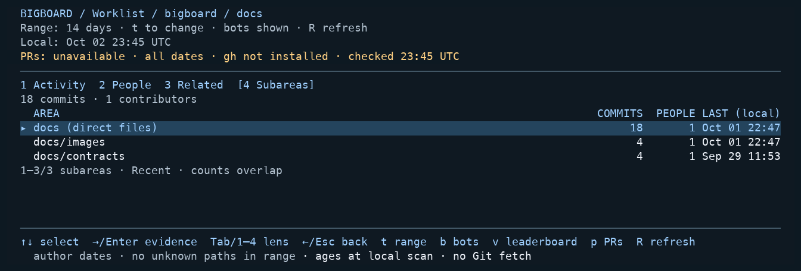

*Subareas, 120 × 18. Direct files are a separate leaf beside child directories.
The historical `docs/contracts` path still appears because selected-range commits
touched it. The counts overlap, so 20 + 6 + 4 is not a repository total.*

Press `4` to refine an automatic area by one literal directory level. `Enter`
on a child opens its evidence and allows further refinement where applicable.
Direct-file leaves do not expand again. Configured named areas preserve their
explicit grouping and do not automatically become directory trees. `s` changes
the Subareas sort, independently of statistics metrics.

When retained PR evidence is available beneath a child, it remains scoped to
the **parent area**, labeled “PARENT AREA PRs”. `p` uses that same parent scope; it does not claim that every
listed PR touches the selected child.

## Inspect a full commit

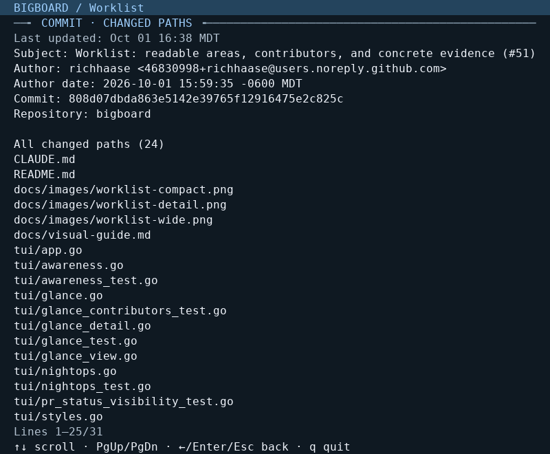

*Commit inspector, 80 × 30. The selected commit changed 29 paths, including files
outside `tui`. The line range shows that more evidence is available below.*

Activity's `Enter` opens the canonical full commit, not only paths assigned to
the selected area. Long subjects, author identities and paths wrap by terminal
cells. Rename/copy origins and generated-file exclusions are labeled when present.

`↑/↓` scrolls lines. `PgUp/PgDown` or `Home/End` moves farther.
`←` or `Esc` returns to Activity; `Tab/Shift+Tab` leaves for the next/previous
lens. `r` refreshes directly from the inspector; `f` edits filters there too. The
inspector's “Last updated” is the same retained local scan time called “Local” in
Activity. A refresh that removes the commit cannot silently retarget this
inspector to a different commit.

## Local and PR freshness are separate

**Local** is the last successful scan for the selected repository. A failed scan
retains previous evidence with **STALE** shown before the name. **Updating…**
keeps the current view usable during a refresh. `e` opens scan-error details when
present. The centered modal keeps the board visible behind it, with a heading
and short summary per repository. `d` expands full technical details; arrows,
paging, and Home/End scroll, `r` retries, and Esc returns to the unchanged board.

**PRs** describes the selected repository's independent all-open snapshot. A
failed or incomplete request remains **STALE**, **PARTIAL**, or **unavailable**.
Shared unavailability appears only in the header; no per-area unknown column
competes with commit titles. Retained area-specific PR signals remain visible.
“Checked” is an attempt time. Retained evidence also reports its last complete
fetch when known and space permits. Unknown inventory is never shown as zero;
`p` provides detailed status and any remote retry/cooldown time.

Lowercase `p` resumes PRs. Shared date and repository viewing scope apply to
all three boards, independently of tracked repositories (`i`). PRs use last-updated
time; local history uses author dates. Activity's `v` opens repository PR context
with the shared scope and temporarily omits saved PR filters. Back restores
Activity and the saved normal PR board. Git contributor and bot filters remain
board-specific. `/` searches the current list; `s` sorts and `S` reverses.

Enter / right opens a centered detail modal over the list. It separates the
title and status fields from coverage, reviewer, affected-area, and file sections.
PR identity and partial/stale warnings remain visible while scrolling.
Arrows, paging, and Home/End navigate lists or
scroll details. Left / Esc closes or returns one level, preserving applied filters. Back from an Activity-linked PR list restores Activity and the previous normal PR state. At a board root, back stays on that board.
`o` opens a valid canonical PR URL in your browser. `r` refreshes repository
history and PR context from any board or detail, including the commit inspector.

GitHub context uses an already installed and authenticated `gh` CLI. Startup and
`r` fetch included repositories' remote-tracking refs before offline scans;
local branches and working trees remain untouched. Remote requests retain their
existing API budgets and cooldowns. There is no timer refresh or automatic retry.

## Shared list layout

The main boards align their list heading, column labels, and first data row.
The heading shows sort and visible range; scope and accepted search text stay
in the shared row above the freshness indicators. Contributors totals are a
compact heading summary. Activity reserves a bounded panel beneath repository
and directory comparisons for the selected scope’s contributors. Enter continues
through the directory hierarchy; the contributor panel follows the selection.

PR rows separate PR number, state, and title, and reserve review, checks, and
updated-age fields. `◇` and a subdued title identify drafts; `●` identifies
open non-drafts. Approved reviews and passing checks are green. Wide lists include
an Author column before Title; narrower metadata rows reserve room for the
author even when repository names are long. The selected-PR preview
appears at 70×24 and above, keeps at least three list entries visible, and shows
the full repository identity, wrapped title, author, draft state, and separate
review/check states. Long titles continue in Enter detail. Repository labels
omit redundant owners only when the remaining names are unambiguous.
`f` opens the common centered filter modal with Shared and This board categories.
`t` opens Range; PR shortcuts `u`/`v`/`k`/`d` open author/review/checks/state.
Left/right or Tab changes category, arrows select, Space stages choices, Enter
applies the whole draft, and Escape cancels. Multiple choices within one category
mean any selected value; categories combine. `/` searches options. Reset shared
selects all time/all repositories; Reset this board and `x` clear board filters
and search while preserving shared scope and navigation. The title is followed
by separate shared-scope and board-filter rows; cache coverage remains distinct.
At 80 columns the title
and metadata occupy separate lines; at 40 columns status and age use a third
line. Commands stay in the command footer, while coverage occupies the final
row. The compact footer groups board navigation, contextual actions, and
help/refresh, with bright keys and quieter labels. Extra shortcuts stay in `?`
help. Optional hints disappear as whole hints instead of being clipped.
Lowercase `r` refreshes, while `i` opens global repository inclusion.

## Contributor statistics

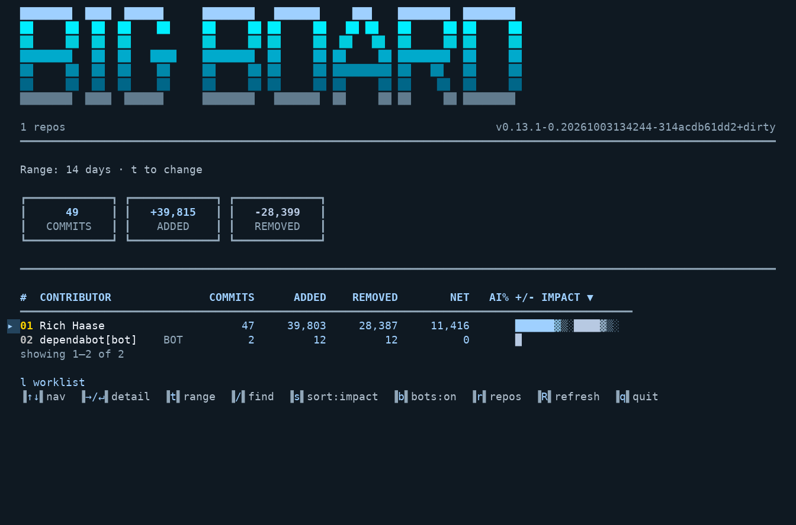

*Contributor statistics before the rename, 120 × 36. Lowercase `a` switches back to Activity; arrows select and `Enter` opens contributor detail.*

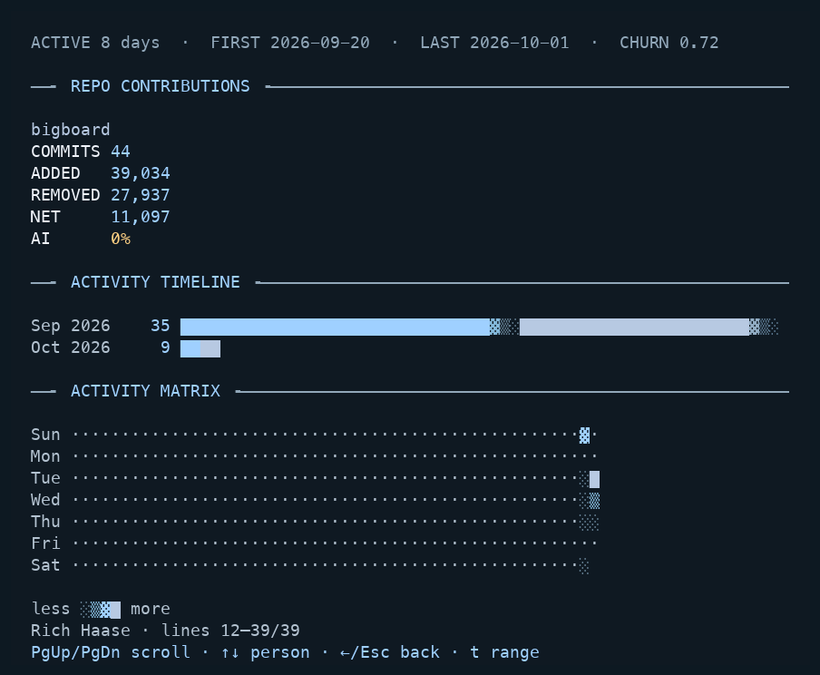

*Contributor detail, 80 × 30, after paging down. Repository values are labeled
rather than squeezed into columns. The footer identifies Rich Haase and shows
lines 12–39/39, while paging and back controls remain visible.*

From Activity, lowercase `c` opens Contributors and `Enter` opens
a contributor.
In detail, `PgUp/PgDown` scrolls, `Home/End` jumps to an edge, and `↑/↓` scrolls the same contributor. `Esc` returns to Contributors. Lowercase `c`, `a`, and `p`
open Contributors, Activity, and all included PRs from either statistics view.
Both statistics views use `t` for the global range. `→` opens the
selected contributor, `←` returns, and `←` at Contributors stays there.

Sorting (`s/S`), name search (`/`), bot toggles (`b`), repository controls (`i`),
and refresh (`r`) live on Contributors. Activity's lens keys
remain specific to Activity. See the [view-specific controls](../README.md#controls)
for search, quit, and overlay behavior.

## Keyboard help

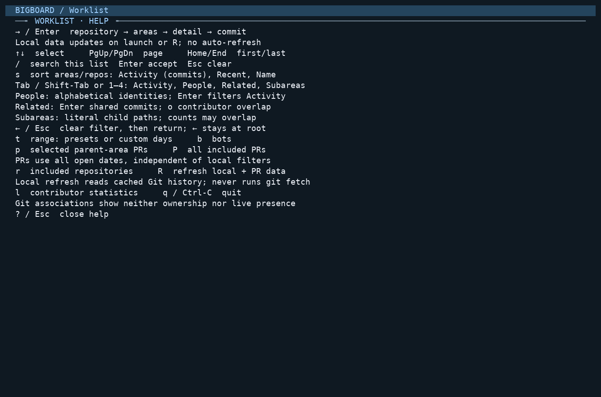

*Earlier help layout, 120 × 36. `?` opens contextual controls from Activity. Navigation uses arrows,
`Enter/Esc`, and the page/edge keys shown here; `c` opens Contributors.*

## Capture details

All fourteen images were captured on October 3, 2026 with the then-current keyboard
controls and indented commit metadata, scanning public Bigboard history at
[3b2f417](https://github.com/richhaase/bigboard/commit/3b2f417bba9864b590e7201eeb006ff8495b4ff4)
in an isolated local clone named `bigboard`. The capture config sets `since` to
`14d`; bots remain shown. Images are rendered from actual PTY cell buffers, with
Git on PATH and `gh` omitted, so “gh not installed” is real and no GitHub request
is made. Timestamps use **UTC**. Counts and ages describe that retained snapshot.

The opt-in `TestActivityTerminalCapture` harness separately tests synthetic
Unicode, long-name, 120-contributor and partial-PR states. It is skipped by normal
tests and is not a production mode. **None of this guide's screenshots uses that
fixture.**
