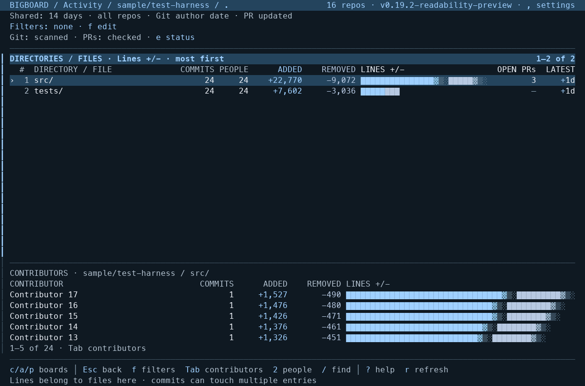
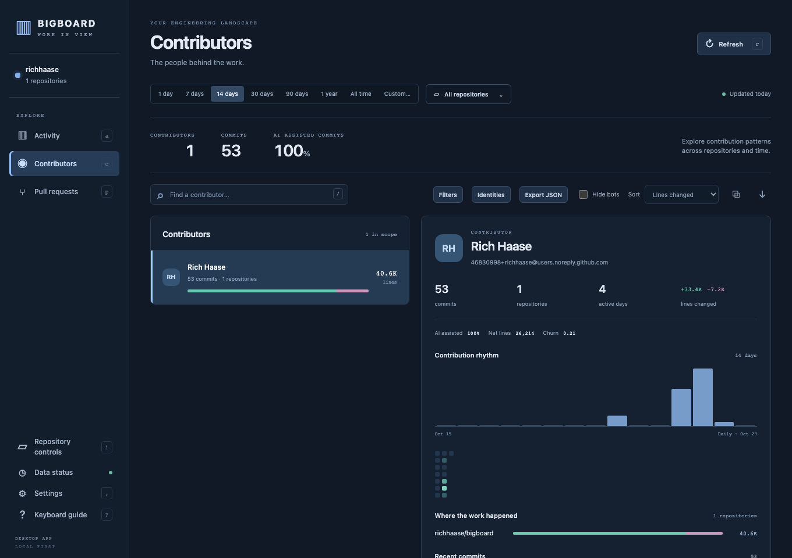
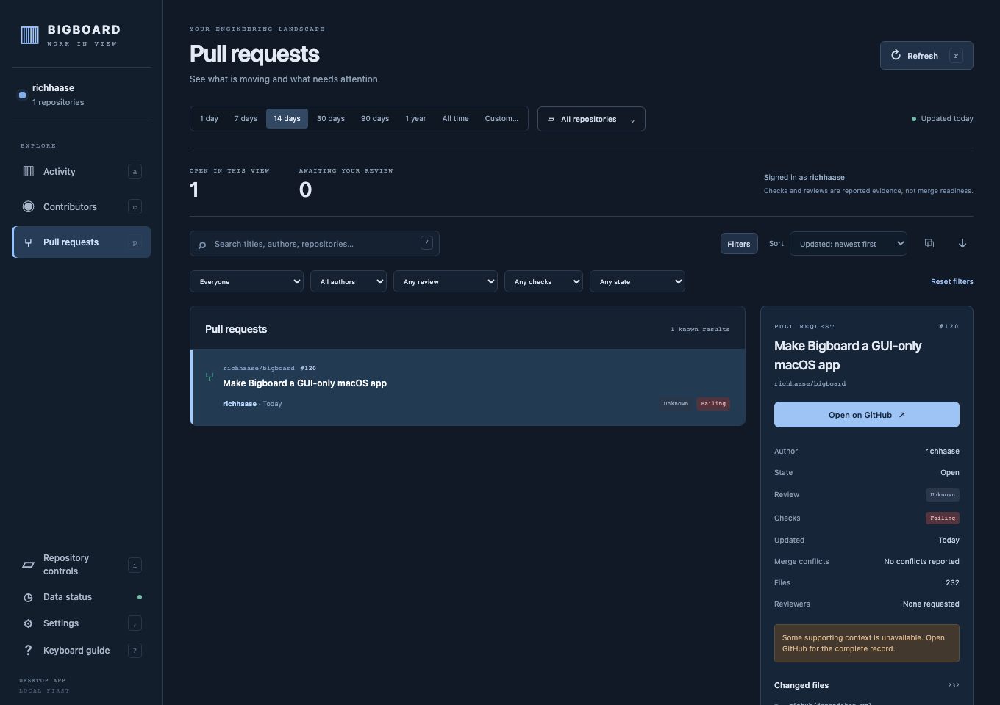
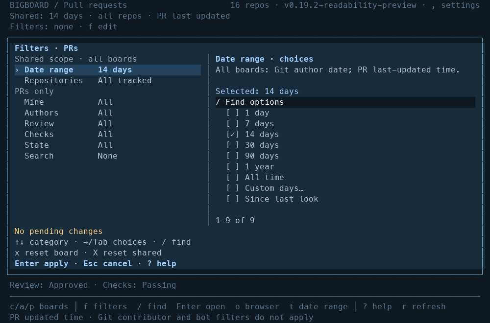
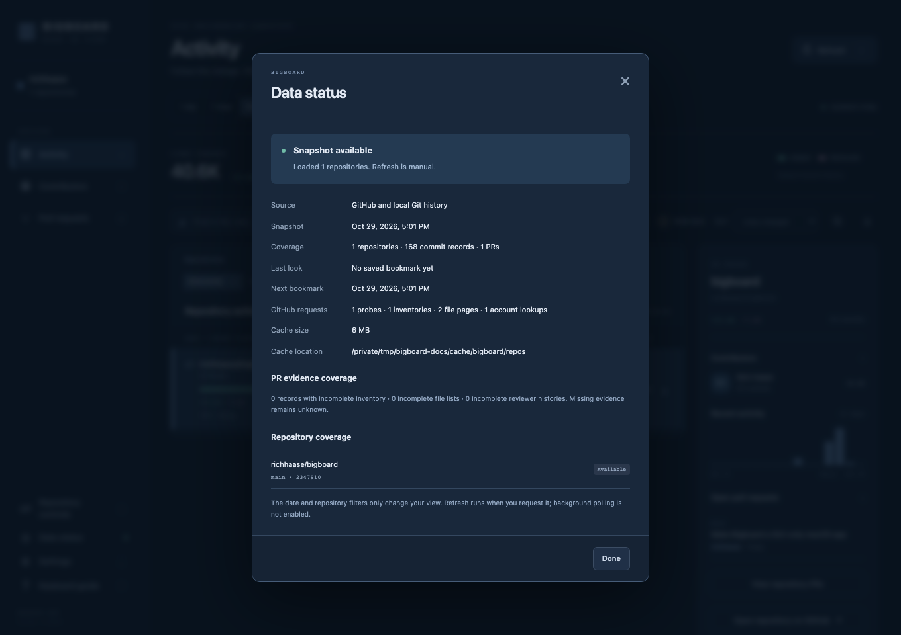
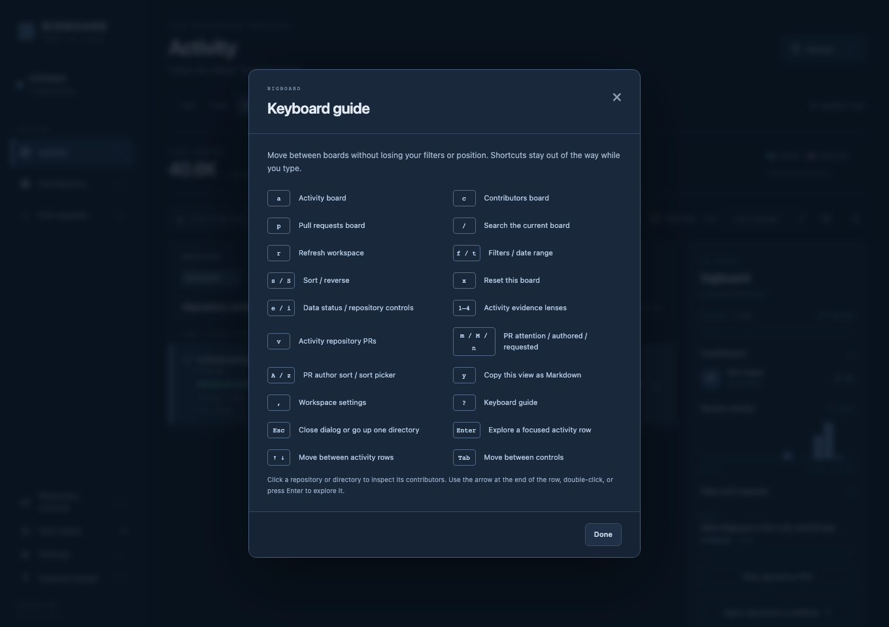

# Big Board visual guide

[README](../README.md) · [Controls and configuration](reference.md)

Start with `bigboard`, complete setup, and use `a`, `c`, and `p` to move between
Activity, Contributors, and PRs. The examples below show the current terminal
renderer with **synthetic data**, not a live organization's activity.

## Compare activity across repositories

*120 × 36. Repositories are ranked by added + removed lines. The selected row's
contributor breakdown appears below it.*

Bars always show added and removed lines. Commits, people, and latest activity
provide other dimensions; `s` changes the sorting and `S` reverses it. Sort
headings describe the direction, such as **Lines +/- · most first**. Unambiguous
repository names omit the owner in the list; the selected scope retains its
full identity. The final row carries date/counting coverage, while static marker
explanations live in help.

Tab moves focus to the contributor pane so you can scroll beyond its first few
entries. The bright heading and left-side marker follow focus. Tab or Esc returns
to the repository ranking.

## Drill into directories and files

*120 × 36. Enter on a repository opens its literal directories and files.*

Each directory's lines belong only to files under that directory. Its contributor
pane answers who made those changes. Enter continues to child directories or a
file's commits; Esc/left returns to the parent. Commit counts can overlap across
directories, so they should not be summed.

With the ranking focused, `o` opens the selected repository, directory, or file
on GitHub. Directory/file links use the retained scan revision and require the
path to exist there; deleted or unavailable paths show a message.

The `1`, `2`, and `3` keys open Commits, People, and Related evidence for the current
scope; `4` returns to the ranking. `v` opens PRs for the selected repository and
Back returns to Activity.

## Start with a contributor

*120 × 36. Contributors is the other direction through the same scoped history.*

Press `c`, select a contributor, and Enter to inspect their repository breakdown,
timeline, and calendar activity. The shared range carries across boards. `m` on
the list opens the identity dialog to set a display name or merge email identities
after review; names alone never merge people.

## Inspect open pull requests

*160 × 36. Authors, titles, review decisions, and checks have their own columns.*

Press `p` for the normal PR board. Green review/check fields mean approved/passing,
not that every merge requirement is satisfied. Drafts use `◇`; open non-drafts use
`●`. The selected preview keeps the full repository and title visible. Enter
opens details and `o` opens the PR in a browser.

`YOU` marks your own PRs. Press `m` for Needs my attention, `M` for your PRs, or
`n` for review requests to you; repeat a shortcut to clear its Mine filter.
Attention includes your failing checks, requested changes, and approved
non-draft PRs with passing checks, plus PRs awaiting your review or updated
since your review. Other filters and shared scope still apply.

`A` groups PRs by author A–Z with newest PRs first per author. `z` opens a direct
sort picker. Tab expands the selected preview into scrollable PR details; Tab
or Esc returns focus to the list. The compact preview adds conflicts, file
counts and requested reviewers when space permits. These controls are newer
than the screenshot above.

The shared date range uses **PR last-updated time** here. `s` includes Attention,
which starts with review requests to you, failing checks, changes requested,
approved PRs, then other PRs. Direction is shown as **priority first** or
**priority last**. `+` on an age means updated since your saved bookmark; `!`
means no update for at least 14 days at the snapshot time.

## Stage filters, then apply

*100 × 30. Shared scope appears above the board-specific categories.*

`f` opens this overview and `t` opens Date range directly. Tab/right moves to
options; left returns to categories. Space stages choices, Enter applies the
whole draft, and Esc cancels. Changes in several categories can be applied
together. `x` stages a board reset; `X` stages a shared-scope reset. Both still
require Enter. Narrow terminals show one focused pane at a time.

Shared scope affects every board. Board-specific filters stay with that board.
Filtering changes what you see, not which repositories refresh. Use Settings
(`,`) for saved repository choices or Repository controls (`i`) for this session's
tracking choices.

## Read freshness and coverage

*100 × 30. `e` opens Data status; `d` there adds diagnostics.*

The shared status row remains compact. This modal shows retained timestamps,
bookmarks, cache location and size, and separate PR inventory/file/reviewer
coverage. Paths under your home directory display as `~`. Stale or partial
evidence remains labeled; a missing file list can make directory associations
unknown even when the PR inventory itself is complete.

## Find the current controls

*100 × 30. Help opens over the current screen and keeps its selection intact.*

`?` or F1 opens help. Commands come first, with explanatory legends afterward.
Arrows and page keys scroll. Esc closes help; F1 also works while entering search
text, when `?` is a literal character. The footer shows a small set of useful
commands rather than repeating the full help list.

## About these captures

These seven images were generated on October 27, 2026 from the readability
preview based on v0.19.2. They use Big Board's `Model.View()` and normal key-update
path with the existing `boardLayoutFixture` sample repositories, contributors,
and PRs. Per-file counts and snapshot times are supplied as synthetic fixtures;
no private repositories, credentials, network requests, or user configuration
are used. Snapshot time is October 27, 2026 at 12:00 UTC, displayed in
America/Denver. PNGs are rasterized from the renderer's ANSI text using Menlo.
They are renderer captures, not designed mockups or claims about real activity.
